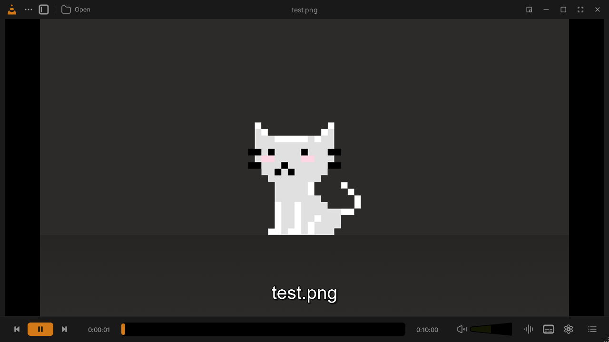
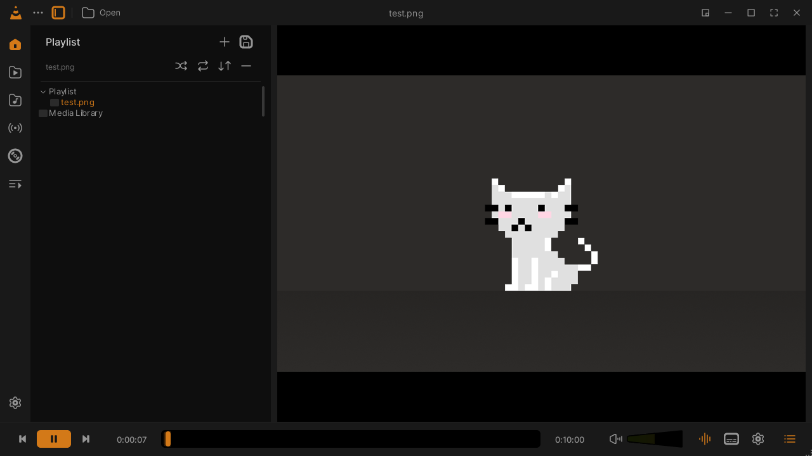
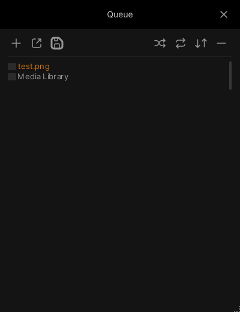
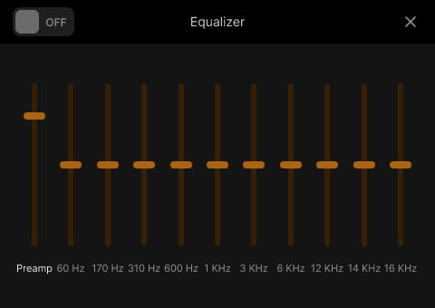
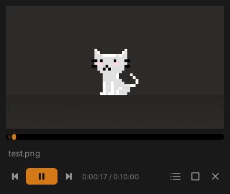
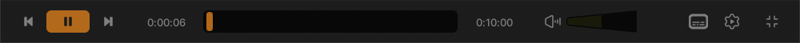

# VLC Redesign skin for VLC 3

A working VLC skin built from **Juxtopposed's "VLC Redesign" Figma Community file**. It brings the dark, orange-accented redesign to the VLC media player you already have installed.



| Sidebar + library tree | Queue | Equalizer |
|---|---|---|
|  |  |  |

| Mini player | Fullscreen controls |
|---|---|
|  |  |

All screenshots are of VLC 3.0.21 running this skin on Windows 11.

## Install

You need **VLC 3.x** (Windows, Linux or macOS builds that include the *Skins2* interface; the standard Windows installer includes it).

### Windows, one command

```powershell
powershell -ExecutionPolicy Bypass -File install.ps1
```

This copies `dist/VLC-Redesign.vlt` to `%APPDATA%\vlc\skins\` and sets VLC to start with the skin. It backs up `vlcrc` before changing it. Close VLC before running it.

- `install.ps1 -NoDefault` copies the skin without making it the default.
- `install.ps1 -Uninstall` switches VLC back to its normal interface.

### Manually (any OS)

1. Download [`dist/VLC-Redesign.vlt`](dist/VLC-Redesign.vlt).
2. In VLC, open **Tools → Preferences → Interface**, choose **Use custom skin**, and select the `.vlt` file.
3. Restart VLC.

To go back, click the gear icon in the skin to open Preferences, choose **Use native style** under Interface, and restart VLC. On Windows you can also run `install.ps1 -Uninstall`.

## What's included

| Design screen | In the skin |
|---|---|
| Player: top bar, video stage, control bar | Main window. The video sits in the design's rounded 10 px frame, and album art (or a VLC cone) shows when there's no video. |
| Seek bar | Black track, brown progress fill and orange handle, matching the design. Hover over it to see the time. |
| Volume wedge (0–200 %) | The design's own wedge component, drawn at 51 fill levels. |
| Sidebar | Click the sidebar button in the top bar. The rail opens the media library, files, folders, network streams, discs and playlists; the panel holds VLC's playlist and media-library tree. |
| Queue popup | Click the list icon in the bottom right. Opens a floating queue with add, load, save, shuffle, repeat, sort and remove. |
| Equalizer | Click the waveform icon. Includes the on/off toggle, preamp and all 10 bands. |
| Mini player | Click the picture-in-picture button in the top bar. |
| Fullscreen | A floating control bar at the bottom of the screen. |

Icons, colours and type come straight from the Figma file: the icons are the file's own components, the colours are its "Dark" colour styles, and the typeface is Inter.

### Limitations

VLC 3's skin engine (Skins2) can only lay out bitmaps, buttons, sliders, text and lists, so some parts of the redesign can't be built as a skin:

- **Library grid and list views, Settings, Onboarding and Open dialogs.** Buttons for these open VLC's standard dialogs instead.
- **Rounded video corners.** VLC draws video in its own native window on top of the skin. The rounded frame shows whenever no video is playing.
- **Light theme.** Only the Dark theme is built so far. The light colour tokens are in the Figma file if you want to add one.
- **Scaling on high-DPI screens.** Skins2 doesn't scale with Windows display scaling, so the skin is drawn at 1× (the design's native size).

## Building from the Figma file

The skin is generated from the `.fig` file, so you can rebuild it after changing the design. The `.fig` file isn't in this repo; download it from Figma Community (**Open in Figma → File → Save local copy**).

```bash
npm install
node tools/figma/decode.js "path/to/VLC Redesign (Community).fig"   # -> build/figma/
npm run build      # -> skin/ (theme.xml, images, fonts)
npm run package    # -> dist/VLC-Redesign.vlt
```

| Path | What it is |
|---|---|
| `tools/figma/decode.js` | Unzips the `.fig` file and decodes Figma's binary "kiwi" format to JSON. |
| `tools/figma/render.js` | A small Figma renderer that outputs SVG and PNG. It handles frames, vectors, text glyphs, images, gradients, masks, shadows, components and instance overrides. Example: `node tools/figma/render.js 187:328 out.png 0.5`. |
| `tools/figma/tree.js` | Prints the node tree, so you can find component IDs. Example: `node tools/figma/tree.js 4 491:1779`. |
| `tools/build-skin.js` | Renders every button, slider and panel from the design's components and writes `theme.xml`. The design tokens and component IDs are at the top of the file. |
| `tools/package.js` | Packs `skin/` into the `.vlt` file. |
| `docs/design/` | Reference renders of the original Figma frames. |

## Credits and licences

- **Design:** "VLC Redesign" by **Juxtopposed**, published on Figma Community. Figma Community files are licensed under [CC BY 4.0](https://creativecommons.org/licenses/by/4.0/). The bitmaps in `skin/images`, the reference renders in `docs/design` and the screenshots are adapted from that design and are shared under the same licence, with attribution to Juxtopposed. Changes from the original: the design was rasterised, restructured into VLC Skins2 components, and in places simplified or recoloured to work within the skin engine.
- **Font:** [Inter](https://github.com/rsms/inter) by Rasmus Andersson, under the SIL Open Font License 1.1 (`skin/fonts/OFL.txt`).
- **Code** (`tools/`, `install.ps1`): MIT, see [LICENSE](LICENSE).
- VLC and the VLC cone are trademarks of VideoLAN. This is an unofficial community skin, not affiliated with VideoLAN or Juxtopposed.
